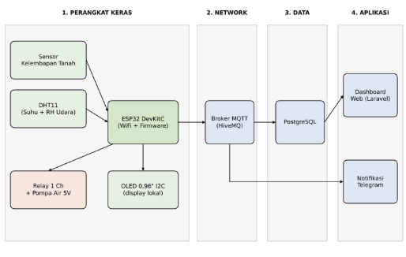
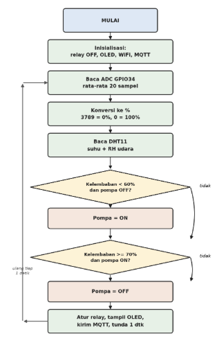

# Petani Pintar — Smart Irrigation Tanaman Cabai Rawit Berbasis IoT

Tugas Besar Praktikum Sistem Internet of Things. Satu purwarupa ini dipakai untuk luaran beberapa mata kuliah sekaligus: Praktikum Sistem Internet of Things, Mata Kuliah Internet of Things, Sistem Kendali, Smart Farming & Aquakultur, serta dashboard web berbasis Laravel pada Pemrograman Web.

## Tim

Dosen pengampu: Ucky Pradestha Novettralita S.Pd., M.Kom.

| Nama | NIM | Tugas |
|---|---|---|
| Apriyudha | H1H024010 | Jalur data MQTT – PostgreSQL, bot Telegram |
| Pandu Adi Utama | H1H024032 | Dashboard web (Laravel), dokumentasi & laporan |
| Alfian Iskandar Zulkarnain | H1H024034 | Perangkat keras & skematik Cirkit, firmware ESP32 |

## Cara kerja singkat

1. Sensor soil moisture kapasitif membaca kelembapan tanah, dan DHT11 membaca suhu serta kelembapan udara.
2. ESP32 menampilkan nilai sensor di OLED dan mempublikasikannya ke broker MQTT (HiveMQ).
3. Logika threshold dengan histeresis: tanah kering (kelembapan < 60%) membuat relay ON sehingga pompa menyiram; tanah basah (kelembapan ≥ 70%) membuat relay OFF.
4. Setiap perubahan status pompa dikirim sebagai notifikasi Telegram.
5. Data sensor dari topik MQTT disimpan ke PostgreSQL. Dashboard web berbasis Laravel membaca data dari PostgreSQL dan menampilkannya sebagai grafik deret waktu.

## Arsitektur

Sistem terdiri dari empat lapis: (1) perangkat keras di lapangan (ESP32, sensor, relay, pompa, OLED), (2) network berbasis MQTT, (3) data PostgreSQL, dan (4) aplikasi berupa dashboard web berbasis Laravel dan notifikasi Telegram.



*Gambar 1. Diagram blok sistem Petani Pintar.*

## Flowchart



*Gambar 2. Flowchart cara kerja sistem.*

## Perangkat keras

| Komponen | Koneksi ke ESP32 |
|---|---|
| Soil moisture kapasitif (VCC/GND/AO) | 3V3 / GND / GPIO34 |
| DHT11 (VCC/GND/DATA) | 3V3 / GND / GPIO15 |
| Relay 1 channel (VCC/GND/IN) | 5V / GND / GPIO26 |
| Relay COM/NO | 5V eksternal / pompa (+) |
| OLED SSD1306 I2C (VCC/GND/SDA/SCL) | 3V3 / GND / GPIO21 / GPIO22 |
| Water pump 5V (−) | GND catu 5V |

Pompa air 5V dicatu dari sumber 5V eksternal melalui kontak COM–NO relay, sehingga arus pompa tidak membebani pin ESP32.

## Struktur repo

```
.
├── README.md
├── docs/
│   ├── laporan-progress-1.docx   # laporan progress 1 (file kumpul)
│   ├── laporan-progress-1.pdf
│   └── img/
│       ├── diagram_blok.png
│       └── flowchart.png
├── firmware/                     # sketch ESP32 (menyusul, progress 2)
└── dashboard/                    # dashboard web Laravel (menyusul)
```

## Tautan proyek

- Repositori GitHub: https://github.com/avriyyy/Tubes_Praktikum-IoT_Smart-Irrigation

## Status

- [x] Progress 1: konsep, skematik Cirkit, diagram blok + flowchart, laporan
- [ ] Progress 2: firmware ESP32, MQTT + PostgreSQL live
- [ ] Final: rakit fisik, dashboard web Laravel, notifikasi Telegram, demo
